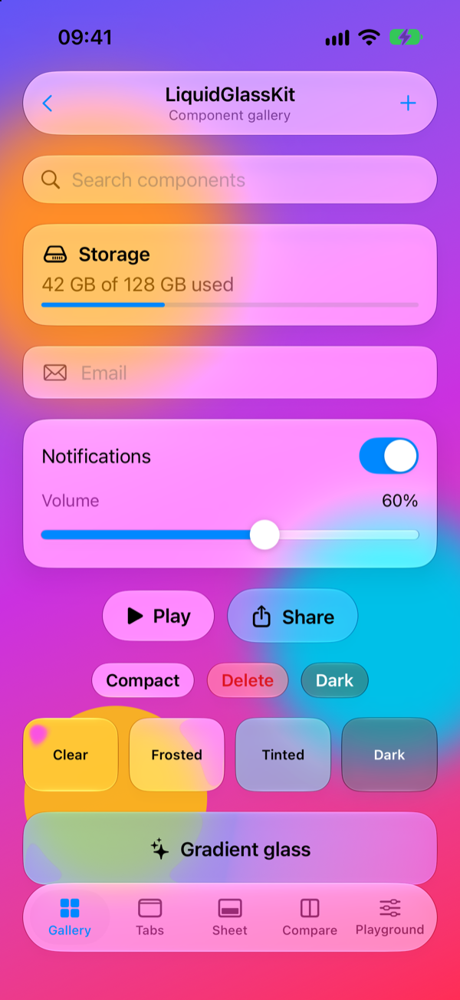
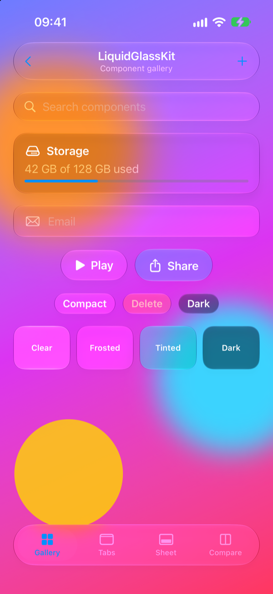
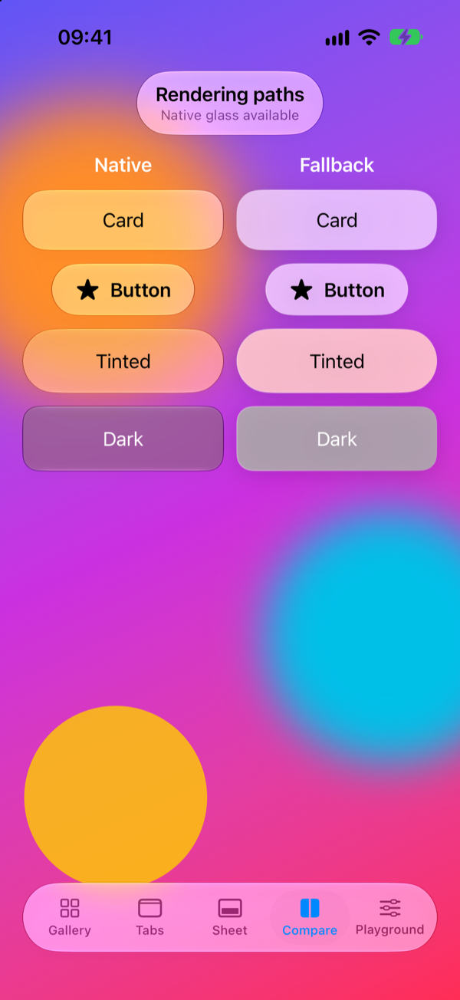
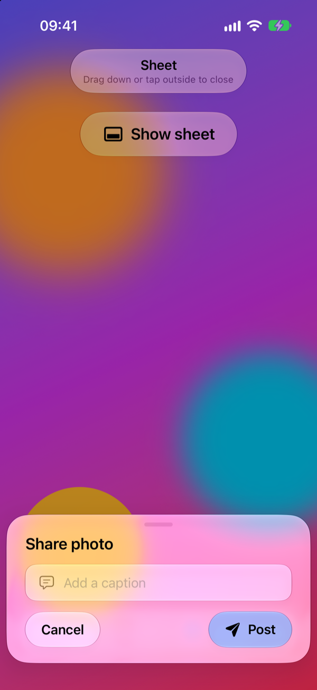
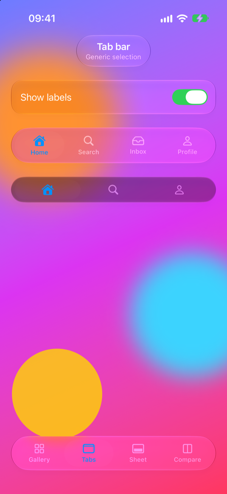
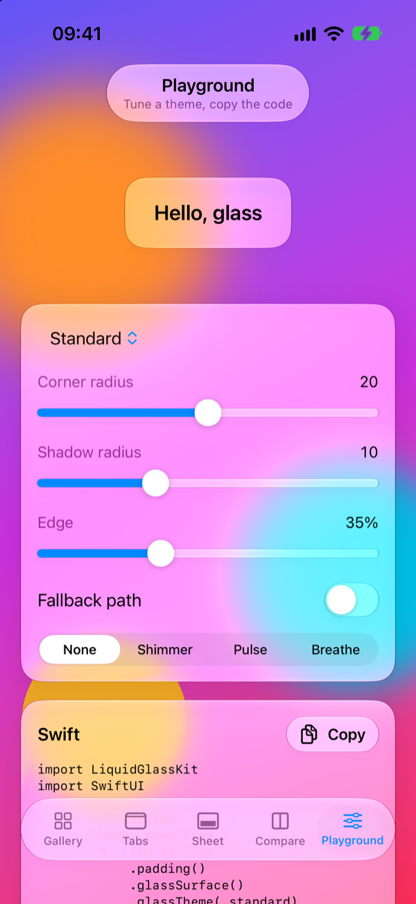
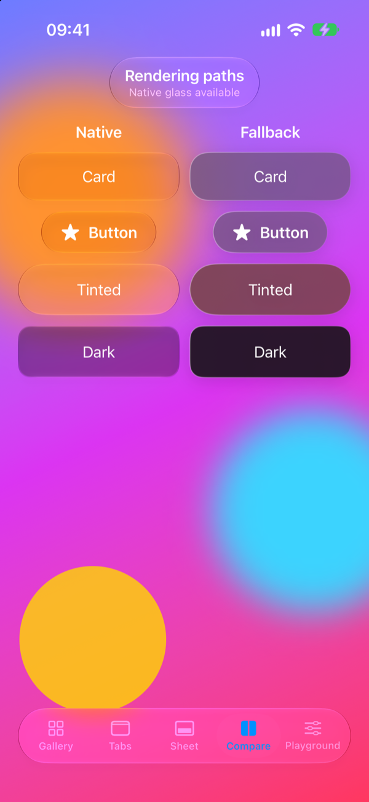

<!-- brand:start -->

<p align="center"><picture><source media="(prefers-color-scheme: dark)" srcset="https://raw.githubusercontent.com/muhittincamdali/LiquidGlassKit/main/.github/brand/banner-dark.svg"><source media="(prefers-color-scheme: light)" srcset="https://raw.githubusercontent.com/muhittincamdali/LiquidGlassKit/main/.github/brand/banner-light.svg"></picture></p>

<!-- lang-selector:start -->
<p align="center"><a href="README.md">English</a> · <a href="README.tr.md">Türkçe</a> · <a href="README.zh-CN.md">简体中文</a> · <a href="README.ja.md">日本語</a> · <a href="README.ko.md">한국어</a> · <a href="README.es.md">Español</a> · <a href="README.de.md">Deutsch</a> · <a href="README.fr.md">Français</a> · <a href="README.pt-BR.md">Português (Brasil)</a> · <a href="README.ru.md">Русский</a></p>
<!-- lang-selector:end -->

<p align="center">
<a href="https://github.com/muhittincamdali/LiquidGlassKit/actions/workflows/ci.yml"></a>
<a href="https://github.com/muhittincamdali/LiquidGlassKit/releases"><picture><source media="(prefers-color-scheme: dark)" srcset="https://raw.githubusercontent.com/muhittincamdali/LiquidGlassKit/main/.github/brand/badge-version-dark.svg"><source media="(prefers-color-scheme: light)" srcset="https://raw.githubusercontent.com/muhittincamdali/LiquidGlassKit/main/.github/brand/badge-version-light.svg"></picture></a>
<a href="https://github.com/muhittincamdali/LiquidGlassKit/blob/main/Package.swift"><picture><source media="(prefers-color-scheme: dark)" srcset="https://raw.githubusercontent.com/muhittincamdali/LiquidGlassKit/main/.github/brand/badge-platforms-dark.svg"><source media="(prefers-color-scheme: light)" srcset="https://raw.githubusercontent.com/muhittincamdali/LiquidGlassKit/main/.github/brand/badge-platforms-light.svg"></picture></a>
<a href="https://github.com/muhittincamdali/LiquidGlassKit/blob/main/Package.swift"><picture><source media="(prefers-color-scheme: dark)" srcset="https://raw.githubusercontent.com/muhittincamdali/LiquidGlassKit/main/.github/brand/badge-language-dark.svg"><source media="(prefers-color-scheme: light)" srcset="https://raw.githubusercontent.com/muhittincamdali/LiquidGlassKit/main/.github/brand/badge-language-light.svg"></picture></a>
<a href="https://github.com/muhittincamdali/LiquidGlassKit/blob/main/LICENSE"><picture><source media="(prefers-color-scheme: dark)" srcset="https://raw.githubusercontent.com/muhittincamdali/LiquidGlassKit/main/.github/brand/badge-license-dark.svg"><source media="(prefers-color-scheme: light)" srcset="https://raw.githubusercontent.com/muhittincamdali/LiquidGlassKit/main/.github/brand/badge-license-light.svg"></picture></a>
</p>

<p align="center">
<a href="#quick-start"><picture><source media="(prefers-color-scheme: dark)" srcset="https://raw.githubusercontent.com/muhittincamdali/LiquidGlassKit/main/.github/brand/button-start-en-dark.svg"><source media="(prefers-color-scheme: light)" srcset="https://raw.githubusercontent.com/muhittincamdali/LiquidGlassKit/main/.github/brand/button-start-en-light.svg"></picture></a>
<a href="https://muhittincamdali.github.io/LiquidGlassKit/documentation/liquidglasskit/"><picture><source media="(prefers-color-scheme: dark)" srcset="https://raw.githubusercontent.com/muhittincamdali/LiquidGlassKit/main/.github/brand/button-docs-en-dark.svg"><source media="(prefers-color-scheme: light)" srcset="https://raw.githubusercontent.com/muhittincamdali/LiquidGlassKit/main/.github/brand/button-docs-en-light.svg"></picture></a>
<a href="https://github.com/muhittincamdali/LiquidGlassKit/tree/main/Examples/LiquidGlassDemo"><picture><source media="(prefers-color-scheme: dark)" srcset="https://raw.githubusercontent.com/muhittincamdali/LiquidGlassKit/main/.github/brand/button-examples-en-dark.svg"><source media="(prefers-color-scheme: light)" srcset="https://raw.githubusercontent.com/muhittincamdali/LiquidGlassKit/main/.github/brand/button-examples-en-light.svg"></picture></a>
</p>

<!-- brand:end -->

LiquidGlassKit is a SwiftUI package for apps that want Liquid Glass surfaces and controls but
still support systems without them. On iOS, macOS, tvOS and watchOS 26 it draws with SwiftUI's
native `glassEffect`; on earlier versions (back to iOS 17, macOS 14, tvOS 17 and watchOS 10)
and on visionOS it draws a `Material` blur with a tint, an edge highlight and a shadow. You
write the same code for every OS.

| Gallery (light)                                  | Gallery (dark)                                 | Native vs fallback                                    |
| ------------------------------------------------ | ---------------------------------------------- | ----------------------------------------------------- |
|  |  |  |

## Highlights

-   **One modifier, two paths** — `glassSurface` picks native glass or the `Material` fallback at
    run time, and `glassRenderingMode(.fallback)` forces the fallback when you want one look
    everywhere.
-   **Ready-made controls** — buttons, a switch style, a slider, cards, text fields, a search bar, a
    floating tab bar with an optional action button, a navigation bar and a bottom sheet, all drawn
    through `glassSurface`.
-   **Effects** — gradient-tinted glass and animated shimmer, pulse and breathe highlights that
    work on both paths.
-   **Themes and presets** — `GlassTheme` sets the material, shape, shadow and edge highlight for a
    whole view hierarchy, `GlassPreset` names 14 ready-made themes, and `GlassCodeExporter` turns a
    theme tuned at run time back into Swift.
-   **Accessibility** — the fallback draws an opaque background when Reduce Transparency is on and
    a stronger edge when Increase Contrast is on, highlights stop with Reduce Motion, the switch
    and slider keep SwiftUI's VoiceOver behavior, the tab bar reports the selected tab, and the
    sheet closes with the escape gesture.
-   **No name clashes** — the API avoids SwiftUI's own names (`glassEffect`,
    `GlassEffectContainer`, `GlassButtonStyle`), so both modules can be imported in one file.
-   **Tested rendering** — Swift Testing suites run on macOS and iOS simulators in CI; offscreen
    renders check that every component draws its glass in the right material on the fallback path.

## Quick start

**1. Add the package**

In Xcode, choose **File › Add Package Dependencies…** and enter the repository URL:

```text
https://github.com/muhittincamdali/LiquidGlassKit.git
```

Keep the dependency rule **Up to Next Major Version** starting at 2.1.0 and click **Add
Package**. In the next dialog, choose your app target for `LiquidGlassKit` and click **Add
Package** again.

**2. Import the module**

```swift
import LiquidGlassKit
```

**3. Use it**

Replace the contents of `ContentView.swift` with this view and run the app (⌘R). A glass card
and a glass button appear over a gradient.

```swift
import LiquidGlassKit
import SwiftUI

struct ContentView: View {
    var body: some View {
        ZStack {
            LinearGradient(colors: [.indigo, .pink], startPoint: .top, endPoint: .bottom)
                .ignoresSafeArea()
            VStack(spacing: 16) {
                GlassCard {
                    Label("Hello, glass", systemImage: "sparkles")
                }
                GlassButton("Tap me", systemImage: "hand.tap") {}
            }
        }
    }
}
```

## Installation

### Swift Package Manager

In Xcode, choose **File › Add Package Dependencies…** and enter the repository URL:

```text
https://github.com/muhittincamdali/LiquidGlassKit.git
```

Or add it to the `dependencies` in your `Package.swift`:

```swift
dependencies: [
    .package(url: "https://github.com/muhittincamdali/LiquidGlassKit.git", from: "2.1.0")
],
targets: [
    .target(name: "YourApp", dependencies: [
        .product(name: "LiquidGlassKit", package: "LiquidGlassKit")
    ])
]
```

## Usage

Glass needs something behind it, so place these views over an image, a gradient or scrolling
content. The views in this README are compiled and rendered by the test suite
([`ReadmeExamplesTests.swift`](Tests/LiquidGlassKitTests/ReadmeExamplesTests.swift)).

### Put any view on glass

```swift
import LiquidGlassKit
import SwiftUI

struct NowPlayingBadge: View {
    var body: some View {
        Label("Now Playing", systemImage: "music.note")
            .padding()
            .glassSurface(.tinted(.purple), in: .capsule)
    }
}
```

Materials: `.clear`, `.frosted`, `.tinted(Color)` and `.dark`. Shapes: rounded rectangle,
capsule, circle and per-corner radii.

### Build a form from controls

```swift
struct SignInForm: View {
    @State private var email = ""
    @State private var query = ""

    var body: some View {
        VStack(spacing: 16) {
            GlassSearchBar(text: $query, prompt: "Search")
            GlassTextField("Email", text: $email, systemImage: "envelope")
            GlassCard {
                Text("We will send you a sign-in link.")
            }
            HStack {
                Button("Cancel", role: .cancel) {}
                    .buttonStyle(.liquidGlass(size: .compact))
                GlassButton("Continue", systemImage: "arrow.right", material: .tinted(.blue)) {}
            }
        }
        .padding()
    }
}
```

### Float a tab bar and open a sheet

```swift
enum Screen: Hashable { case home, search, profile }

struct RootView: View {
    @State private var screen = Screen.home
    @State private var showsSheet = false

    var body: some View {
        ZStack(alignment: .bottom) {
            Color.indigo.ignoresSafeArea()
            GlassTabBar(selection: $screen) {
                GlassTab("Home", systemImage: "house", value: Screen.home)
                GlassTab("Search", systemImage: "magnifyingglass", value: Screen.search)
                GlassTab("Profile", systemImage: "person", value: Screen.profile)
            }
            .padding()
        }
        .glassSheet(isPresented: $showsSheet) {
            Text("Sheet content").padding()
        }
    }
}
```

`GlassTabBar` works with any `Hashable` selection, and its builder supports `if` and `for`. The
sheet closes when dragged down, when the dimmed background is tapped, or with the accessibility
escape gesture. It is not available on tvOS.

### Add a switch, a slider and effects

```swift
struct PlayerSettings: View {
    @State private var shuffle = false
    @State private var volume = 0.6

    var body: some View {
        VStack(spacing: 16) {
            GlassCard {
                VStack(spacing: 14) {
                    Toggle("Shuffle", isOn: $shuffle)
                        .toggleStyle(.liquidGlass)
                    GlassSlider("Volume", value: $volume, format: .percent)
                }
            }
            Label("Golden hour", systemImage: "sun.horizon")
                .padding()
                .glassGradient([.orange, .pink], direction: .horizontal, in: .capsule)
            GlassButton("Upgrade", systemImage: "sparkles", material: .tinted(.purple)) {}
                .glassHighlight(.shimmer, in: .capsule)
        }
        .padding()
    }
}
```

The switch style keeps `Toggle`'s accessibility, and VoiceOver users adjust the slider by one
step at a time. Highlights are not drawn when Reduce Motion is on. `GlassSlider` is not
available on tvOS.

### Theme every view and choose the rendering path

```swift
struct ThemedApp: View {
    var body: some View {
        RootView()
            .glassTheme(GlassTheme(material: .tinted(.indigo), shape: .roundedRectangle(cornerRadius: 12)))
            .glassRenderingMode(.automatic) // or .fallback to use the Material look everywhere
    }
}
```

Start from one of the 14 presets in `GlassPreset.all`, adjust it, and turn the result into a view
you can paste into your project:

```swift
var theme = GlassPreset.named("Ocean")?.theme ?? .standard
theme.shadowRadius = 4
let source = GlassCodeExporter().viewCode(named: "PromoCard", theme: theme)
```

### API overview

| API                                                             | What it does                                                                                          |
| --------------------------------------------------------------- | ----------------------------------------------------------------------------------------------------- |
| `glassSurface(_:in:interactive:)`                               | Puts glass behind any view. Native `glassEffect` on OS 26, `Material` fallback elsewhere.             |
| `GlassGroup`                                                    | Wraps `GlassEffectContainer` on OS 26 so nearby glass shapes blend; a pass-through elsewhere.         |
| `GlassButton`, `.buttonStyle(.liquidGlass)`                     | Capsule glass buttons in three sizes, with pressed, disabled and destructive states.                  |
| `.toggleStyle(.liquidGlass)`                                    | Switch with a glass track that fills with the tint when on; keeps `Toggle` accessibility.             |
| `GlassSlider`                                                   | Slider on a glass track with steps counted from the lower bound and any `FormatStyle`. Not on tvOS.   |
| `GlassCard`                                                     | Padded container on glass.                                                                            |
| `GlassTextField`                                                | Text field with optional SF Symbol and a focus ring.                                                  |
| `GlassSearchBar`                                                | Capsule search field with clear and Cancel buttons.                                                   |
| `GlassTabBar`                                                   | Floating tab bar, generic over any `Hashable` selection; builder supports `if` and `for`.             |
| `GlassTabBarAction`                                             | Round button after the tabs for the screen's primary action.                                          |
| `GlassNavigationBar`                                            | Floating title bar with leading and trailing items.                                                   |
| `glassSheet(isPresented:material:content:)`                     | Floating bottom sheet; dismiss by drag, tap outside or the accessibility escape gesture. Not on tvOS. |
| `glassGradient(_:direction:intensity:material:in:interactive:)` | Glass with a gradient tint, on both rendering paths.                                                  |
| `glassHighlight(_:color:in:)`                                   | Animated shimmer, pulse or breathe light over glass; off with Reduce Motion.                          |
| `GlassTheme`, `GlassRenderingMode`                              | Environment values for default material/shape/shadow, and for forcing the fallback path.              |
| `GlassPreset`                                                   | 14 named themes with display names, for pickers and settings screens.                                 |
| `GlassCodeExporter`                                             | Writes themes, materials, shapes and colors as Swift source that uses this package.                   |

## Demo

[`Examples/LiquidGlassDemo`](Examples/LiquidGlassDemo) is an iOS app with a component gallery,
tab bars, a sheet, a native-vs-fallback comparison and a playground that tunes a theme and shows
its code. Open `LiquidGlassDemo.xcodeproj`, choose
an iPhone simulator and run; the [demo's README](Examples/LiquidGlassDemo/README.md) lists its
screens and launch arguments. CI builds it for every pull request and every push to main.

| Sheet (light)                                      | Tab bars (dark)                              | Playground (light)                                     | Native vs fallback (dark)                                  |
| -------------------------------------------------- | -------------------------------------------- | ------------------------------------------------------ | ---------------------------------------------------------- |
|  |  |  |  |

<sub>Screenshots from the demo app on the iOS 27 simulator, captured with
[`scripts/screenshots.sh`](scripts/screenshots.sh).</sub>

## Documentation

Reference documentation and articles:

-   [API reference](https://muhittincamdali.github.io/LiquidGlassKit/documentation/liquidglasskit/)
    on GitHub Pages, built from the DocC catalog in
    [`Sources/LiquidGlassKit/LiquidGlassKit.docc`](Sources/LiquidGlassKit/LiquidGlassKit.docc).
    In Xcode, **Product › Build Documentation** opens the same pages offline.
-   Release notes: [CHANGELOG.md](CHANGELOG.md).

## Guides

-   [Getting Started](https://muhittincamdali.github.io/LiquidGlassKit/documentation/liquidglasskit/gettingstarted)
    — add the package step by step and put the first glass surfaces on screen.
-   [Building a Screen with a Floating Tab Bar](https://muhittincamdali.github.io/LiquidGlassKit/documentation/liquidglasskit/buildingafloatingtabbarscreen)
    — a title bar, search field, cards, tab bar and sheet over scrolling content, in five steps.
-   [Rendering Paths](https://muhittincamdali.github.io/LiquidGlassKit/documentation/liquidglasskit/renderingpaths)
    — what users on each OS see, and how to force the fallback.
-   [Theming](https://muhittincamdali.github.io/LiquidGlassKit/documentation/liquidglasskit/theming)
    — presets, custom themes and per-component materials.
-   [Adding Controls and Effects](https://muhittincamdali.github.io/LiquidGlassKit/documentation/liquidglasskit/addingcontrolsandeffects)
    — the glass switch and slider, gradient glass, highlights and the tab bar action button.
-   [Tuning and Exporting a Look](https://muhittincamdali.github.io/LiquidGlassKit/documentation/liquidglasskit/tuningandexportingalook)
    — pick a preset, adjust a theme at run time and copy it as Swift.

## Requirements

| Platform  | Minimum version       |
| --------- | --------------------- |
| iOS       | 17                    |
| macOS     | 14                    |
| tvOS      | 17                    |
| watchOS   | 10                    |
| visionOS  | 1                     |
| Toolchain | Swift 6.0 · Xcode 26+ |

The package needs Xcode 26 or later even for older deployment targets, because the native path
is compiled against the OS 26 SDK.

## Architecture

-   `Sources/LiquidGlassKit/Core` holds the value types: `GlassMaterial`, `GlassShape`,
    `GlassTheme`, `GlassPreset` and `GlassRenderingMode`, and `GlassCodeExporter`.
-   `Sources/LiquidGlassKit/Surface` holds `glassSurface` and `GlassGroup`, the only places that
    call SwiftUI's glass API, and the gradient and highlight modifiers built on `glassSurface`.
-   `Sources/LiquidGlassKit/Components` builds every control on top of `glassSurface`, so the theme
    and the rendering mode apply to all of them.

`glassSurface` resolves the `GlassRenderingMode` from the environment against
`GlassRenderingMode.isNativeGlassAvailable`, an `#available(iOS 26, macOS 26, tvOS 26,
watchOS 26, *)` check that is always `false` on visionOS, where SwiftUI marks `glassEffect`
unavailable. Each material maps to both paths:

| `GlassMaterial` | Native path                 | Fallback path                         |
| --------------- | --------------------------- | ------------------------------------- |
| `.clear`        | `Glass.clear`               | `.ultraThinMaterial`                  |
| `.frosted`      | `Glass.regular`             | `.thinMaterial`                       |
| `.tinted(c)`    | `Glass.regular.tint(c)`     | `.regularMaterial` + color overlay    |
| `.dark`         | `Glass.regular.tint(black)` | `.ultraThickMaterial` + black overlay |

### Tests

```bash
swift test                                                   # macOS
xcodebuild test -scheme LiquidGlassKit \
  -destination 'platform=iOS Simulator,name=iPhone 17 Pro'   # iOS Simulator
```

The Swift Testing suites cover material and shape logic, theme and gradient clamping (including
NaN), rendering mode resolution, the tab builder, the sheet's dismissal thresholds, slider
snapping for unusual steps and ranges, highlight timing, preset lookup, and the exporter's
output, two samples of which are compiled in the test target. Offscreen renders on the
fallback path check that every component draws its glass in the theme's material, that an
explicit material overrides the theme, that labels on dark glass are white and destructive
labels red, that the sheet dims the background only while presented, and that Reduce
Transparency draws an opaque background. CI runs the suite on macOS, on an iOS 26 simulator and
on an iOS 18.6 simulator, where only the fallback path exists, and builds the library for every
platform in `Package.swift`.

`ImageRenderer` does not capture the blur, and native glass only in part, so the tests check the
fallback's tint and coverage, and that each component renders differently on the native path
than on the fallback path; they do not check the final glass look.

## Roadmap

No release after 2.1.0 is scheduled yet. Bug reports and feature requests are tracked in
[issues](https://github.com/muhittincamdali/LiquidGlassKit/issues).

## Contributing

Contributions are welcome. Read the [contributing guide](https://github.com/muhittincamdali/LiquidGlassKit/blob/main/CONTRIBUTING.md) and the [code of conduct](https://github.com/muhittincamdali/.github/blob/main/CODE_OF_CONDUCT.md) before opening a pull request. Report security issues privately as described in the [security policy](https://github.com/muhittincamdali/.github/blob/main/SECURITY.md).

## License

Released under the MIT license. See [LICENSE](LICENSE).
